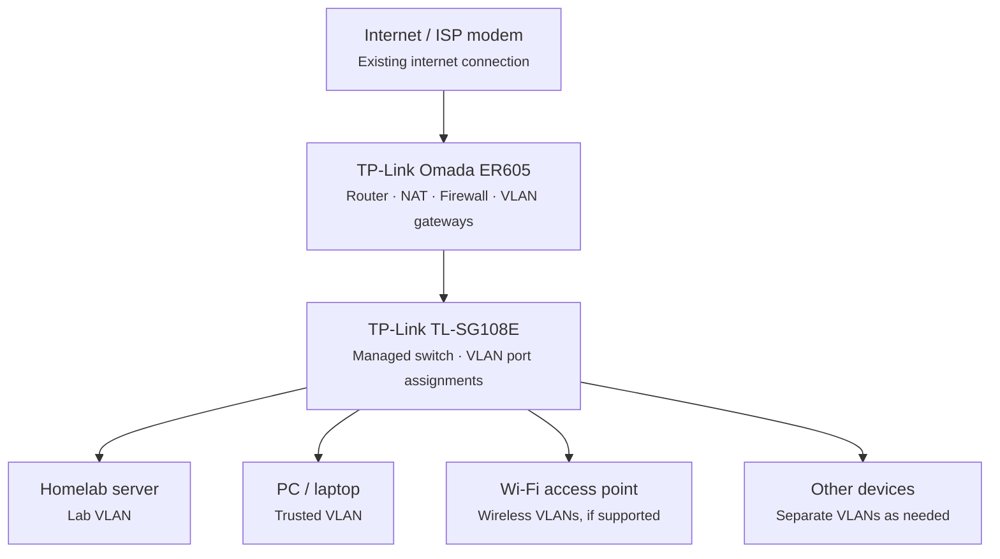

# Initial network design

**Status:** Starting point (2026-10-18)

This is the design the homelab network starts from. It will change as the lab grows. When it does, record the change and the reasoning in `docs/decisions/` rather than rewriting this page.

## Physical setup

This is a conceptual topology. Each endpoint connects to a port on the one TL-SG108E switch. The diagram does not imply separate physical switches.

## Components

| Layer | Device | Responsibilities |
| --- | --- | --- |
| Internet | ISP modem | Existing internet connection |
| Edge | TP-Link Omada ER605 | Routing, NAT, firewall, gateway for each VLAN |
| Switching | TP-Link TL-SG108E | Managed switch, assigns switch ports to VLANs |
| Endpoints | Homelab server | Lab VLAN |
| | PC / laptop | Trusted VLAN |
| | Wi-Fi access point | Wireless VLANs, if the AP supports them |
| | Other devices | Separate VLANs as needed |

## Planned VLANs

| VLAN | Purpose | VLAN ID | Subnet |
| --- | --- | --- | --- |
| Trusted | Personal PCs and laptops | _TBD_ | _TBD_ |
| Lab | Homelab server and lab workloads | _TBD_ | _TBD_ |
| Wireless | Wi-Fi clients, if the AP supports VLANs | _TBD_ | _TBD_ |
| Other | Additional segments as needed | _TBD_ | _TBD_ |

## Open items

- [ ] Choose VLAN IDs and subnets
- [ ] Decide which switch port connects to the router (trunk) and which ports carry each VLAN
- [ ] Confirm whether the Wi-Fi access point supports multiple SSIDs or VLAN tagging
- [ ] Define firewall rules between VLANs (for example, Trusted can reach Lab, Lab cannot reach Trusted)

## Related

- [Hardware inventory](../infrastructure/hardware-inventory.md)
- [Journal: 2026-10-17 network equipment purchase](../../journal/2026-10-17-network-equipment-purchase.md)
