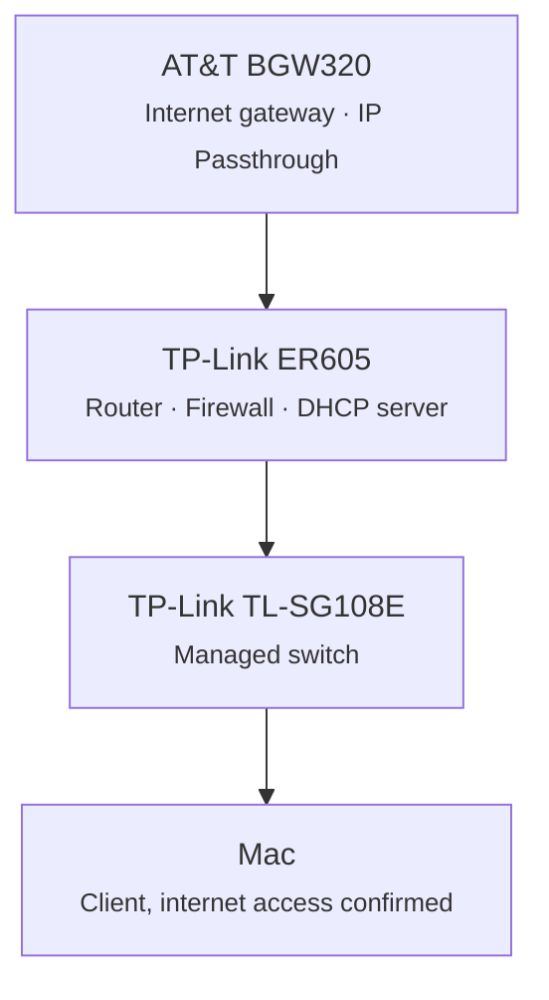

# 2026-10-18: Physical network working end to end

## Milestone

The physical network is up and passing traffic from the internet through to a client.

## Current setup

| Device | Role |
| --- | --- |
| AT&T BGW320 | Internet gateway with IP Passthrough |
| TP-Link ER605 | Router, firewall, and DHCP server |
| TP-Link TL-SG108E | Managed switch |
| Mac | Connected through the switch with internet access |

## Notes

With IP Passthrough enabled on the BGW320, the ER605 handles routing, firewalling, and DHCP for the network behind it.

## Next steps

- [ ] Choose VLAN IDs and subnets (see [initial design](../docs/architecture/initial-design.md))
- [ ] Configure VLANs on the ER605 and TL-SG108E
- [ ] Record firmware versions in the [hardware inventory](../docs/infrastructure/hardware-inventory.md)
